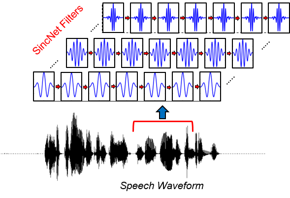
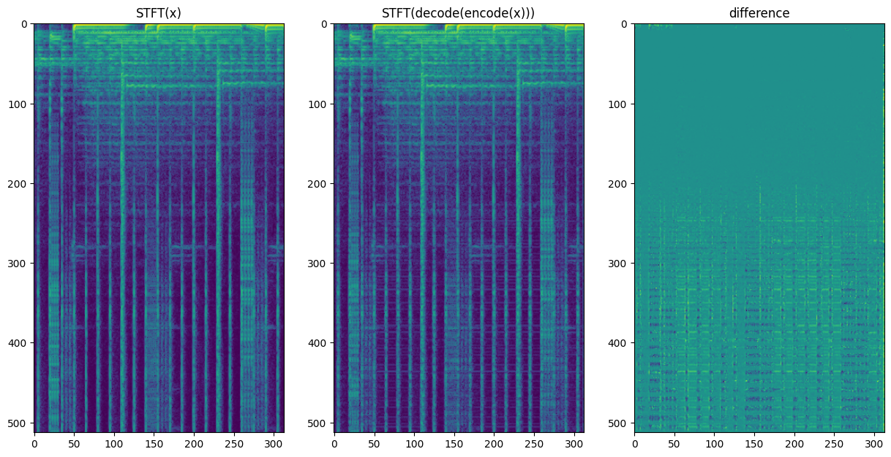
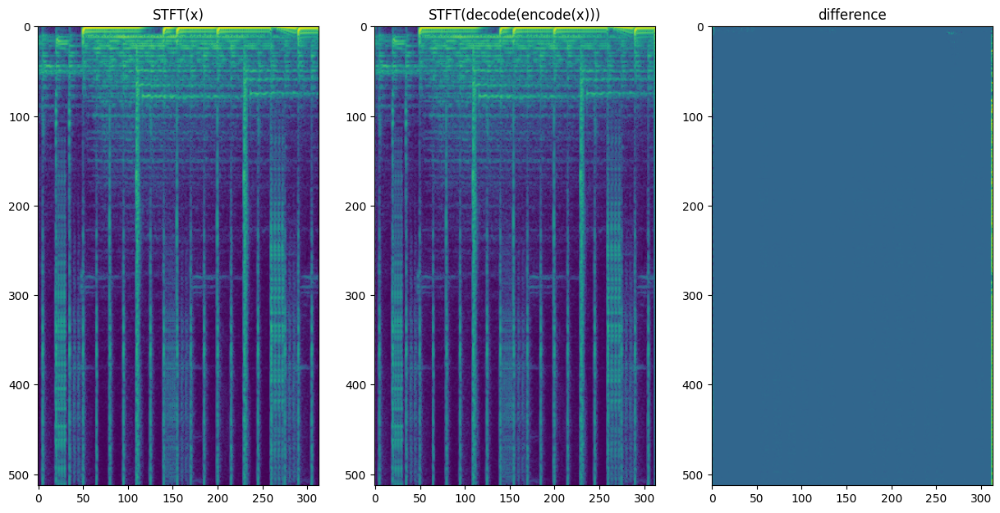

<div align="center">

<h1>iSincNet / Fast Invertible Audio Frontend</h1>

<em>A drop-in, differentiable spectrogram layer for PyTorch that decodes back to the waveform exactly, with no trained weights. Linear, interpretable, CPU-fast. Any scale: linear, mel, Bark, ERB.</em>
<br/><br/>

[](https://github.com/wkzng/iSincNet/actions/workflows/ci.yml)
[](https://www.python.org/)
[](LICENSE)
</div>

---

**iSincNet** turns a waveform into an interpretable 2-D spectrogram (a deterministic SincNet
filterbank) and back into the waveform. The decoder is a closed-form inverse of the encoder: no
vocoder, no training, no checkpoints. Pick any frequency scale (linear, mel, Bark, ERB);
reconstruction is length-exact and, for a well-conditioned bank, near-exact (about 100+ dB, up to
roughly 125 dB).

<p align="center">
  
</p>

Filterbank kernels and example spectrograms: [docs/filters.md](docs/filters.md). For a controlled
comparison and an explanation of why warped banks need adaptive bandwidth, see
[why the sinc envelope matters](docs/sinc_enveloppe.md).

## Quick start

```bash
pip install .            # core (torch, numpy, librosa)
pip install .[demo]      # adds matplotlib + soundfile for the demo notebook
```

```python
import torch
from sincnet.model import SincNet

# nothing to download: the decoder is the analytical inverse of the encoder
model = SincNet(
  fs=16_000, fps=128, n_bins=256,
  scale="mel",            # any scale: "lin" | "mel" | "bark" | "erb"
  component="complex", causal=False, decoder_type="exact",
).eval()

wav = torch.randn(1, 16_000)                            # (B, T)
with torch.no_grad():
    spec  = model.encode(wav)                           # (B, 2, F, T) signed real/imag spectrogram
    recon = model.decode(spec, length=wav.shape[-1])    # (B, T) exact, training-free, length-preserving

    # optional mu-law quantization for a compact representation:
    q, scale = model.mulaw.quantize(spec)
    recon = model.decode(model.mulaw.dequantize(q, scale), length=wav.shape[-1])
```

See the [demo notebook](demo_sincnet.ipynb).

### Select STFT or SincNet from a dictionary

```python
from sincnet import create_spectrogram_transform

params = dict(spec_type="stft", fs=16000, fps=128, n_bins=256,
              q_bits=8, overlap=4, scale="lin", causal=False)
frontend = create_spectrogram_transform(params)
spec = frontend.encode(wav)  # (B, 2, 256, 129) for (B, 16000) input

params["spec_type"] = "sincnet"
frontend = create_spectrogram_transform(params)
spec = frontend.encode(wav)  # same shape
```

The factory accepts mono `(B, L)` or `(B, 1, L)` waveforms and returns real/imaginary
channels with `F = n_bins` and `T = 1 + L // (fs // fps)` for either backend.
`fs` must be divisible by `fps`. It selects SincNet's `component="complex"` and
STFT's `layout="channel"`; conflicting settings are rejected. Direct constructors
still support their existing layouts. The dictionary is copied, and unknown keys
are rejected. Options for the other backend are ignored, so changing `spec_type`
is sufficient: `overlap` applies to STFT; `scale`, `causal`, `apply_sinc_envelope`,
`decoder_type`, and `cg_iters` apply to SincNet. Matching shapes
do not imply matching frequency scales, coefficient values, or reconstruction accuracy.

STFT's `overlap` sets `win_length = overlap * hop_length`, with
`hop_length = fs // fps` and `n_fft = 2 * n_bins`. It does **not** change the output
shape. Overlap 2 gives 50% window overlap; 4 gives 75%. A longer window averages
over more time and offers finer effective frequency discrimination at the cost of
temporal localization. It also changes overlap-add reconstruction behavior. The
window must fit inside the FFT: `overlap * hop_length <= 2 * n_bins`. At 16 kHz
and 128 fps, overlap 4 therefore requires at least 256 bins. SincNet uses its own
fixed kernel duration; this option does not change it. STFT drops the Nyquist bin,
so reconstruction is approximate even with a suitable window. Pass the original
waveform length to `decode` to preserve lengths that are not multiples of the hop.

SincNet now retains the right boundary frame for hop-aligned inputs, adding one
frame compared with earlier versions. Its analytical decoders default to
`(T - 1) * hop_length` samples, matching STFT; the learned decoder still emits
`T * hop_length` samples. Existing saved spectrograms and learned-decoder pipelines
may need their framing assumptions updated.

Both frontends accept the same quantizer configuration through their constructors
and the factory:

```python
params.update(
    q_bits=8,
    mulaw_kwargs=dict(coordinate_system="demodulated", pre_scaling=True,
                      q_mag=8, q_phi=6, eps=1e-8, dither=False),
)
frontend = create_spectrogram_transform(params)
tokens, scale = frontend.mulaw.quantize(frontend.encode(wav))
reconstructed_spec = frontend.mulaw.dequantize(tokens, scale)
```

`mulaw_kwargs["coordinate_system"]` supports `cartesian`, `polar`, `predictive`,
`demodulated`, and `trig` (and the existing aliases). `mulaw_kwargs` forwards
settings supported by the chosen quantizer (`q_bits` overrides the top-level
default; `pre_scaling` controls magnitude normalization before companding): `q_mag` and `q_phi` for
polar variants, `q_mag` and `q_trig` for trig, `eps` and `dither` for all, and
`mag_silence_threshold` for polar/predictive. Unsupported settings raise an error.
Demodulation frequencies and frame rate come from the frontend automatically;
STFT uses `k * fs / n_fft`, while SincNet uses its filter centers.

The factory defaults to 6-bit polar quantization with pre-scaling disabled for
both transforms. Direct constructor defaults remain unchanged: STFT uses 8-bit
Cartesian with pre-scaling enabled; SincNet uses 6-bit polar with pre-scaling
disabled. Both also support
`frontend.initialise_mulaw("polar", q_bits=8, pre_scaling=True, q_phi=6)` to replace
the quantizer after construction. Quantizers expect real/imaginary channel
spectrograms `(B, 2, F, T)`; trig produces three token channels and restores two
when dequantizing. With STFT's direct `layout="complex"`, convert the spectrum to
real/imaginary channels before quantization. The factory always selects channel
layout.

## Decoders

All share the same `encode` / `decode` API and are length-exact (pick via `decoder_type`):

| `decoder_type`   | reconstruction                                   | weights | differentiable | remark                                                                |
|:----------------:|:-------------------------------------------------|:-------:|:--------------:|:----------------------------------------------------------------------|
| `fast` (default) | ~37 dB, single-pass `conv_transpose` + equalizer | none    | yes            | fast path; fine for training losses                                   |
| `exact`          | ~100+ dB, conjugate-gradient pseudo-inverse      | none    | yes            | implicit backward, O(1) memory in iterations; for end-to-end training |

## Invertibility

Whether `decode(encode(x))` is exact is fixed, before any training, by `n_bins`, `fps`, and the
kernel length. The bank is per-frame invertible (a clean closed-form inverse exists) once:

```
2 * n_bins >= kernel_size = coverage * fs / fps        <=>        n_bins * fps >= (coverage / 2) * fs
```

At `fps = 128` that means `n_bins >= 256`. `SincNet` warns at construction when a config sits below
the line. Comparing `STFT(x)` with `STFT(decode(encode(x)))`:

**128 bins (below the line): visible residual.**


**512 bins (well above the line): indistinguishable.**


Full derivation and more figures: [docs/invertibility_constraint.md](docs/invertibility_constraint.md).

## References
- [1] Ravanelli & Bengio, *Speaker Recognition from raw waveform with SincNet* [arXiv](https://arxiv.org/abs/2109.08910)
- [2] *Filterbank design for end-to-end speech separation* [arXiv](https://arxiv.org/pdf/1910.10400), which decomposes SincNet into a `cos * sin` product (the formulation used here)
- [3] *Toward end-to-end interpretable convolutional neural networks for waveform signals* [arXiv](https://arxiv.org/pdf/2405.01815)
- [4] *PF-Net: Personalized Filter for Speaker Recognition from Raw Waveform* [arXiv](https://arxiv.org/abs/2105.14826)

Related discussion, SincNet vs STFT: https://github.com/mravanelli/SincNet/issues/74

## SincNet in the wild
- https://github.com/mravanelli/SincNet
- https://github.com/mravanelli/pytorch-kaldi
- https://github.com/PeiChunChang/MS-SincResNet
